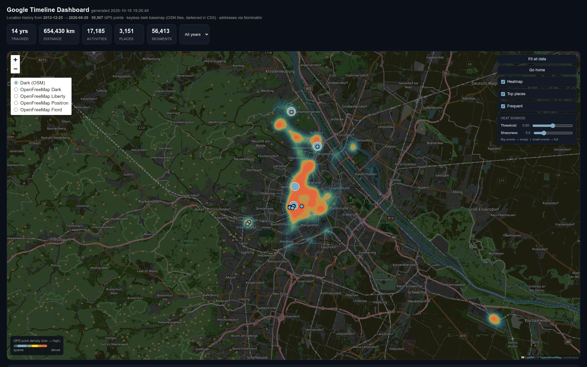
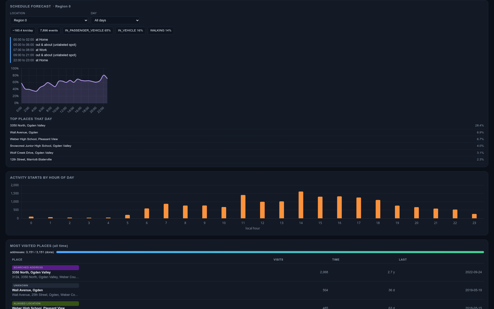
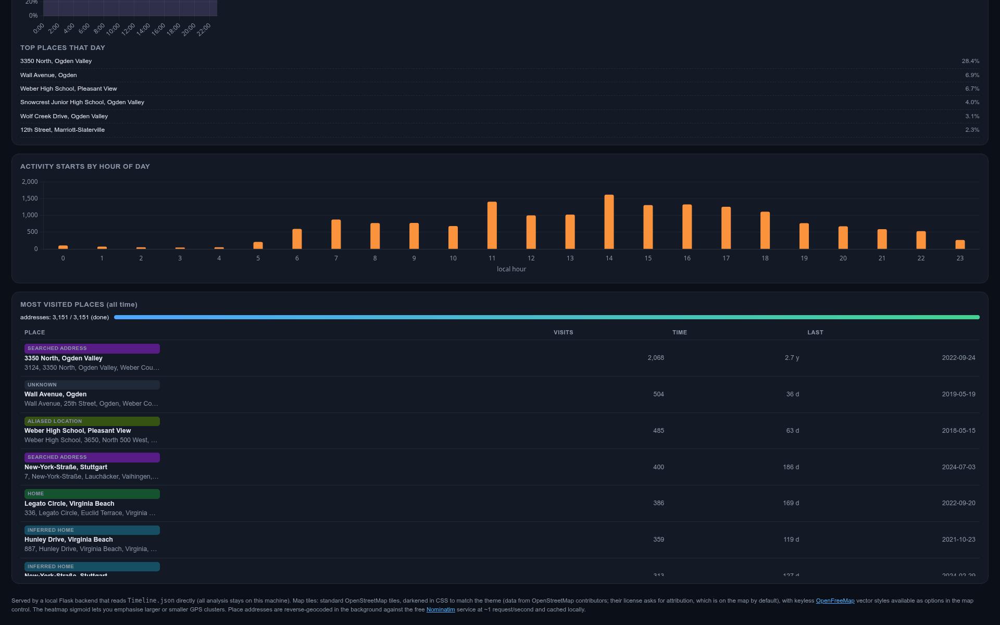

# google-timeline

Google's timeline recorded my phone's location from 2013 to 2026.
Every stop, every commute, every flight wrote itself into one export,
77 megabytes of it. When I finally switched timeline off, I wanted to
keep the part I actually care about: a map of where my life was,
plus an answer to the question I have been dodging for years, where
do I actually spend my days?

So I built this. A dashboard for your own export.

## What it does

- Reads the official "Your Data" timeline export (one JSON file:
  semantic segments, raw GPS pings, your location profile) and turns
  it into a map of the whole period.
- Clusters your stops into regions (the big blob is where you live
  and work, the far ones are trips) and your visits into places (home,
  office, the places you keep returning to).
- Draws a per-year heatmap of every position on a dark basemap
  (standard OpenStreetMap tiles, darkened in CSS to match the theme,
  with keyless OpenFreeMap vector styles as alternatives), and the
  yearly rhythms: when you moved,
  how far, what you did it by.
- Then the part I actually built it for. A schedule forecast. Given
  your own history, where are you most likely to be, by day of week
  and hour. A lightweight Bayesian schedule model with Laplace
  smoothing over sparse day-of-week by hour tables; trained only on
  this file. It does not know where you are now. It knows where you
  usually are, and it shows you.

## What it looks like

A map of more than a decade of one person. Home and office burn hot,
the trips sit in the distance, and the forecast answers "where is
you most likely at this hour of this day" from the history alone.







## The shape of it

One file in, one dashboard out. No accounts, no backend database,
and on `127.0.0.1` only, so the only thing that ever sees the data
is you.

```
  Timeline.json ────► Flask (app.py)
  (one export)          │
                        ├── load_data: parse segments, cluster places
                        │   into regions, build the heat grid, train
                        │   the forecast
                        │
                        ├── SQLite addresses.db (optional)
                        │   reverse-geocodes the places you visit most,
                        │   throttled and cached; pause it and it resumes
                        │   later, so the map can call them "Home"
                        │   instead of "48.05, 11.44"
                        │
                        ▼
              static/ + the map, heat and forecast routes,
              one page, one file, no build step
```

Two deliberate choices.

1. **The forecast is the deliverable, not the map.** The map is the
   obvious thing to do with a timeline. The forecast is the weird
   thing: your own location, predicted by your own habits, with no
   live tracking involved. That is what the dashboard leads with.
2. **The real data never goes in this repo.** A 77 MB file of exactly
   where one person was, for more than a decade, including their
   house. The repo ships a synthetic timeline that `run_sample.py`
   generates on the fly, and a `.gitignore` that keeps your real
   export out.

## Run it (synthetically)

```bash
pip install -r requirements.txt
python3 run_sample.py
```

Then open http://127.0.0.1:8080.

`run_sample.py` is a **seeded, offline** entrypoint for this repo.
It writes a synthetic ten-year timeline that matches the real export
schema exactly (a metro with home, office and a gym, two four-day
trips a year to a far city, weekday commutes, weekend cycling,
a little noise, two dozen recent raw GPS pings), then runs the
**real** `app.py` against it end-to-end and serves the dashboard on
port 8080. No geocoding, no real timeline, and the only network it
touches is the one-time download of the map and chart libraries from
their CDNs on first boot. The numbers on screen are fake; the code
doing the work is the code in this repo.

It's deterministic from a fixed seed, so the sample everyone clones
renders the same.

## Run it (for real)

```
app.py            the Flask app: parse, cluster, heat grid, forecast
index.html        the page: map, heat, per-year charts, forecast
run_sample.py    the offline sample entrypoint
requirements.txt
static/           the page's CSS and JS (no build step)
```

Point it at your export: put `Timeline.json` in the repo directory,
then

```bash
python3 -m venv .venv && .venv/bin/pip install -r requirements.txt
.venv/bin/python app.py
```

It reads the export on first load, geocodes your most-visited stops
into `addresses.db` (throttled and cached; pause it and come back
later; the cache is what makes the second day fast), and serves on
http://127.0.0.1:5000. If you don't want it to reverse-anywhere at
all, set `DISABLE_GEOCODE=1`. The app serves on `127.0.0.1` and
only that host can talk to it.
